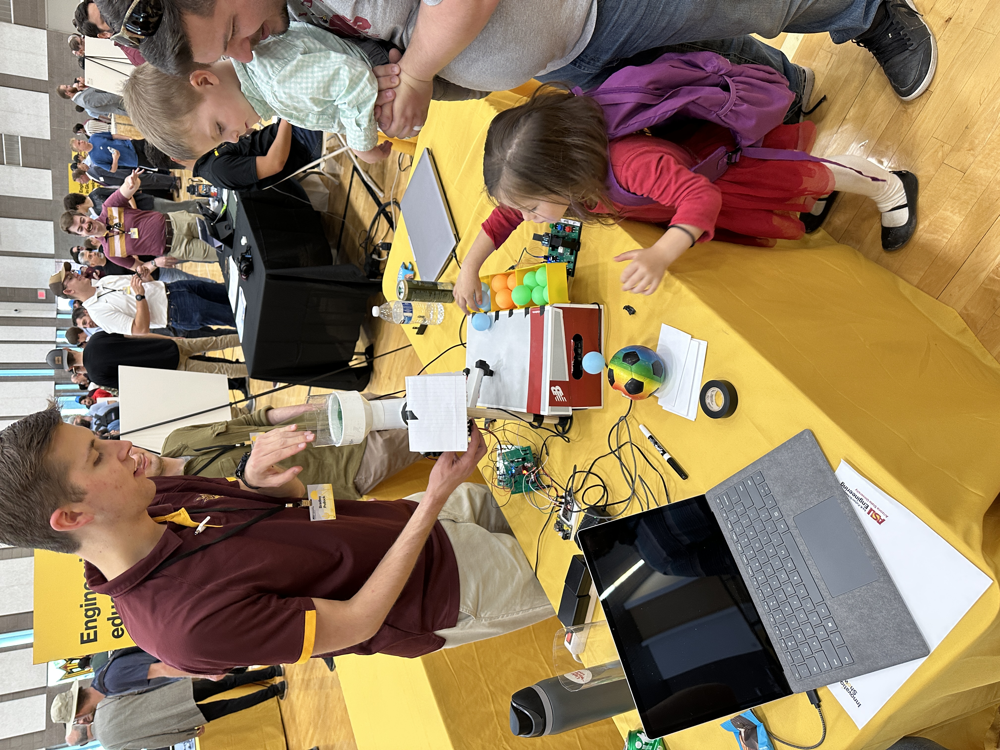

## Introduction

Planning is important for projects and creating a block diagram can help greatly when making schematics and building prototypes. Our block diagram is split into the 4 subsystems and the ways they connect together. The temperature and main control systems connect to all 3 other subsystems as they control the subsystems for the motor encoder and control. The resulting structure is like a web with each of the control subsystems being connected across the web.

## Images

.png)  
**Figure 1:** Main controller block diagram

 
**Figure 2:** The motor control block diagram

<!-- 
  
**Figure 3:** Innovation Showcase Spring '25, where the products were a STEM-themed display that demonstrates a single scientific/engineering concept with the intended user of K-12 students interested in learning about science, technology, engineering, or math. -->

## Conclusions and Future Work

## External Links

[Ayaan Ahmed's Block Diagram]()

[Connor Loos' Block Diagram](https://cmloos.github.io/cmloos_RAS304_F26/01-Block-Diagram/Block-Diagram/)

[Elijah Koiki's Block Diagram](https://kek-koiki.github.io/kkoiki_RAS304_F26/01-Block-Diagram/Block-Diagram/)

[Walker Knaggs' Block Diagram](https://wknaggs.github.io/wknaggs_RAS304_F26/01-Block-Diagram/Block-Diagram/)

## References

