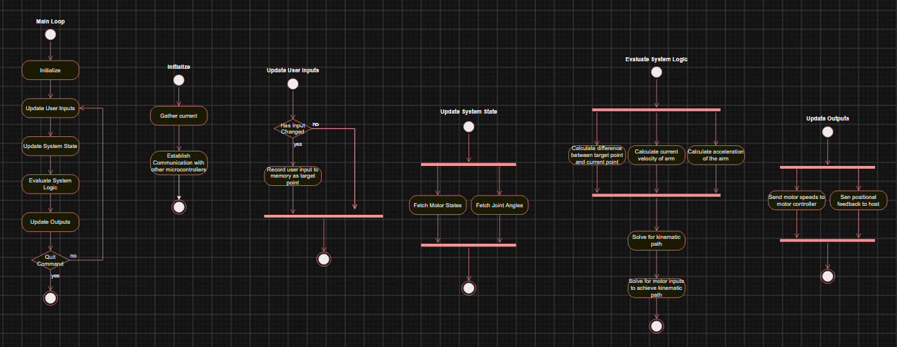
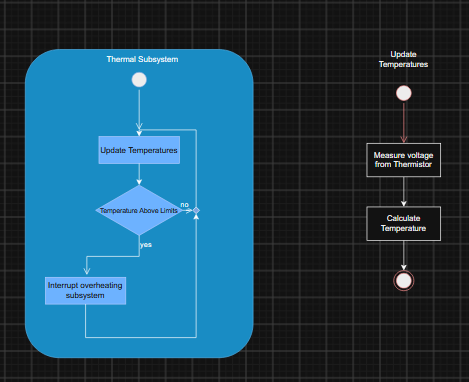
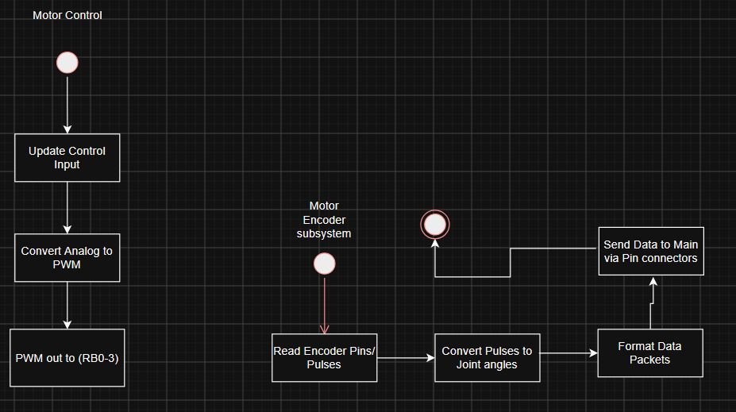

## Introduction

A small 2 Degree of Freedom robotic arm requires motor controllers for precise movement needing encoders, a microcontroller for computaion, and a method of actuating the motors to perform the movements. An additional subsystem can be added for safety to maintain functionality of the motor controller and the safety of the user. The software is the main driving component of this, as allowing the individual microcontrollers to communicate can lead to better results as the system will be able to take into account the angle of the motor and the temperature of the components.

## Images

**Figure 1:** Main Controller Software Proposal

**Figure 2:** Thermal Subsystem Software Proposal

**Figure 3:** Motor Controller and Encoder Software Proposal

## External Links

[Link to Draw.io](https://app.diagrams.net/#G1Q0b9KVD7Obe9O0Oip9BZI2KxdWa8fXgX#%7B%22pageId%22%3A%22r9VNxDttQobcUXQ038Bd%22%7D)

## References

